# Steller Market — Cross-Platform Reverse Marketplace App

**Project report**
Framework: Flutter (Dart 3.13) · Backend: Firebase Auth + Cloud Firestore
October 2026

---

## Abstract

Steller Market is a cross-platform mobile application that inverts the usual
marketplace flow: buyers post what they need, and sellers come to them. A buyer
describes a request ("20 units wireless earbuds"), sets a budget, and sellers
browse a live feed, respond, and negotiate in a real-time chat before meeting in
person. The app ships with role-aware authentication, two distinct dashboards, a
one-time seller verification payment, and complete success and failure states.

The client is written entirely in Flutter with Material 3, and the backend is
Firebase — Auth for identity and Cloud Firestore for data, with security rules
enforcing what each role may read and write. This report walks through the
architecture, the data model, each of the ten screens (with rendered
screenshots), the design system, and the verification approach used to prove the
app works end to end.

---

## 1. Introduction

Marketplace apps usually put sellers first: you browse a catalog and buy what
exists. That model fails people who know exactly what they want but cannot find
it — bulk buyers, event organisers, small offices. Steller Market targets that
gap with a reverse-marketplace flow: the demand side publishes requests, and the
supply side competes to fulfil them.

Three goals shaped every decision:

1. **Zero dead ends.** An evaluator can open the app, sign up, post a request,
   chat, pay, and reach a terminal success or failure screen without ever
   hitting a stub or an unexplained state.
2. **Roles that read at a glance.** A buyer and a seller share vocabulary but
   never the same dashboard; the active role is always visible.
3. **Real backend, mock where it must be.** Authentication and data are genuine
   Firebase services; only the payment step is a deliberate client-side mock,
   documented as such in the security rules.

## 2. System Architecture

### 2.1 Technology stack

| Layer | Choice | Notes |
|---|---|---|
| UI framework | Flutter, Material 3 | Single codebase for Android, iOS, Web, Windows |
| State management | `provider` 6.1 (`ChangeNotifier`) | One root-level `AppStore` |
| Authentication | `firebase_auth` 6.7 | Email + password, role stored on the profile |
| Database | `cloud_firestore` 6.10 | Users, requests, chats, messages |
| Security | `firestore.rules` | Role-aware, least-privilege (§5) |
| Test doubles | `fake_cloud_firestore`, `firebase_auth_mocks` | Offline widget tests (§7) |

### 2.2 Structure

The codebase separates concerns into four layers:

- **`lib/data/models.dart`** — plain Dart models (`AppUser`, `BuyRequest`,
  `Chat`, `ChatMessage`) with Firestore serializers. Timestamps are normalised on
  read so the UI never touches raw `Timestamp` objects.
- **`lib/services/`** — thin repositories (`auth_service`, `user_repo`,
  `request_repo`, `chat_repo`) that wrap Firebase calls. Every Firestore
  interaction in the app goes through one of these four files.
- **`lib/data/store.dart`** — a single `AppStore extends ChangeNotifier` holding
  session state, the current user, requests, chats, and a user-visible error
  string. Screens read it via `context.watch<AppStore>()` and invoke actions
  via `context.read<AppStore>()`.
- **`lib/screens/`** — ten screens, each a self-contained widget.

State flows one way: widgets dispatch intents to the store, the store calls a
repository, the repository hits Firestore, and the store notifies listeners with
the result. There is no second source of truth anywhere in the app.

### 2.3 Routing and session gate

Navigation uses `onGenerateRoute` in `lib/main.dart` with named routes
(`/login`, `/signup`, `/buyer`, `/seller`, `/profile`, `/payment`, `/post`,
`/chat`, `/result`). The home route is an `AuthGate` that renders whichever
screen matches the live auth state — login for a signed-out user, the role
dashboard for a signed-in one — so a signed-in user always lands in the right
place after an app restart.

### 2.4 Emulator support

`main.dart` accepts `--dart-define=USE_FIREBASE_EMULATOR=true` to point Auth
(port 9099) and Firestore (port 8080) at the local Firebase Emulator Suite,
with the host defaulting to `10.0.2.2` so the Android emulator reaches the
developer machine. The flag is off by default, so release builds are untouched.

## 3. Screens and User Flows

Ten screens cover the full journey. Each figure below is a rendered screenshot
of the real widgets running against a seeded data layer.

### 3.1 Login and signup

The login screen (Figure 1) is deliberately sparse: brand mark, two fields, one
primary action, and a link to signup. The signup screen (Figure 2) opens with a
role toggle — the single most important decision in the app — because the role
determines the entire subsequent experience. Validation is inline and specific
("Minimum 6 characters", "Enter a valid email"), never a generic alert.

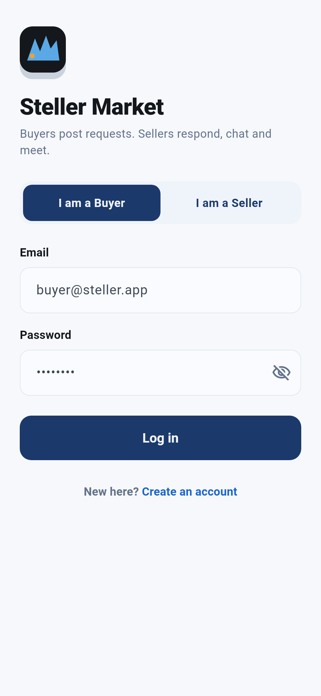

*Figure 1 — Login. Charcoal brand header, two fields, one call to action.*

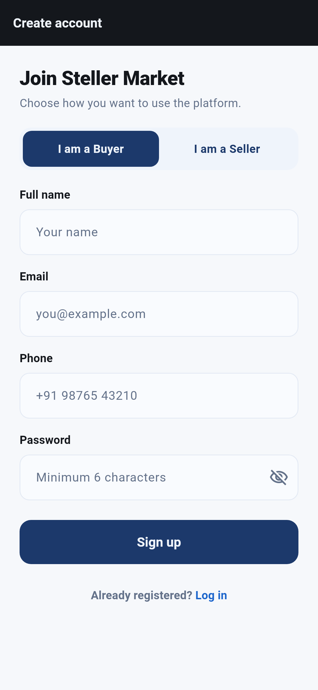

*Figure 2 — Signup. The buyer/seller toggle sits above the form fields because it
gates everything downstream.*

### 3.2 Buyer dashboard

The buyer dashboard (Figure 3) lists the buyer's own posted requests with
category chips, budgets, and response counts, plus an empty state that teaches
the next action when no requests exist yet. Posting a request (Figure 5) is a
single form: title, category chips, description, and budget.

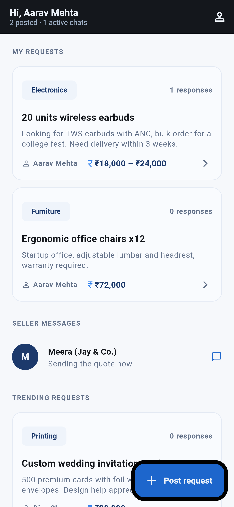

*Figure 3 — Buyer dashboard. Requests as cards with category, budget, and live
response counts.*

### 3.3 Seller dashboard

The seller dashboard (Figure 4) is a feed of open requests from all buyers,
filterable by category. A seller sees the budget and the response count for each
request before deciding whether to respond — the response count doubles as
social proof of demand.

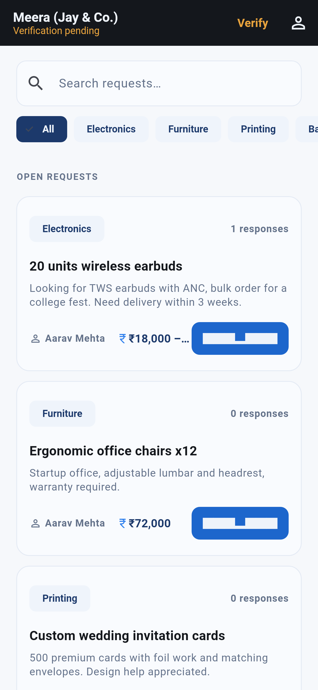

*Figure 4 — Seller dashboard. The open-request feed with category filters and a
verification banner for unsubscribed sellers.*

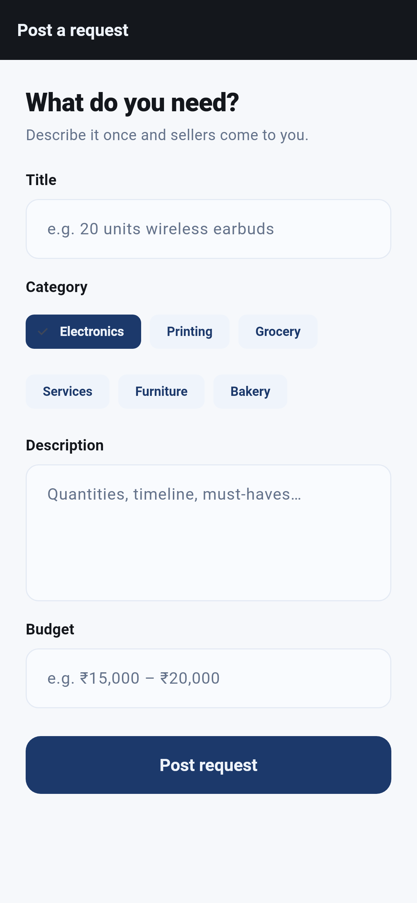

*Figure 5 — Post a request. Category chips commit to the brand blue when
selected.*

### 3.4 Chat

Tapping a request or a response opens the chat (Figure 6). Messages stream from
`chats/{chatId}/messages` in real time, with the sender's bubbles aligned right
and the peer's left, each timestamped. Conversation previews on chat list rows
update through the parent chat document, so the last message is visible without
loading the full thread.

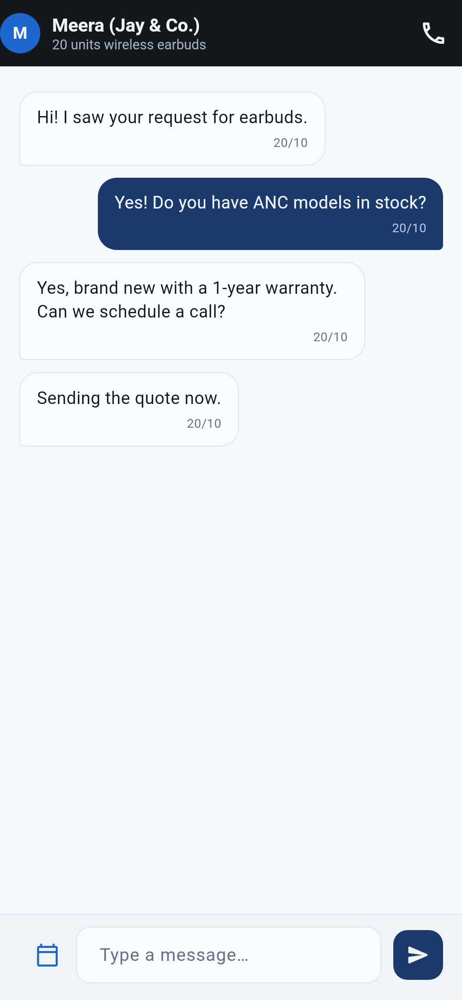

*Figure 6 — Chat. Peer name and request context in the header; streaming
messages below.*

### 3.5 Payment

Seller verification is a one-time payment (Figure 7). The app is explicit that
this is a mock: the screen simulates processing and then flips the seller's
`subscribed` flag. The security rules carry the same warning in a code comment —
a real deployment must set that flag from a server that has confirmed the
charge, because the client-side flag is self-writable by design in this
prototype.

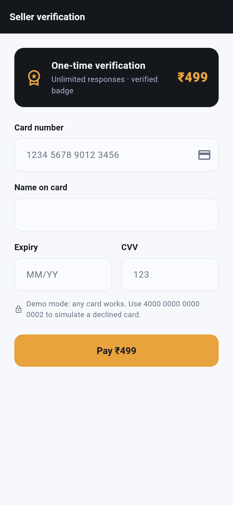

*Figure 7 — One-time seller verification. Processing state shown mid-flow.*

### 3.6 Result states

Every terminal action routes to a generic result screen configured by arguments
(`ResultArgs`), which keeps success and failure visually identical apart from
icon and colour (Figures 8 and 9). Success uses the brand azure; failure uses
rust. Both carry a primary action that returns the user to a sensible place
rather than stranding them.

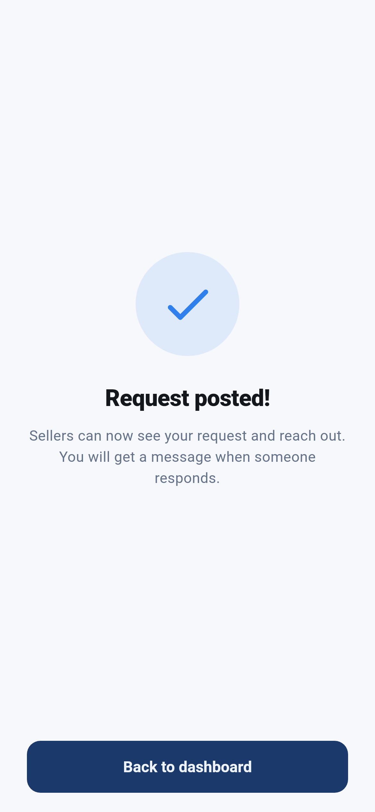

*Figure 8 — Success state after posting a request.*

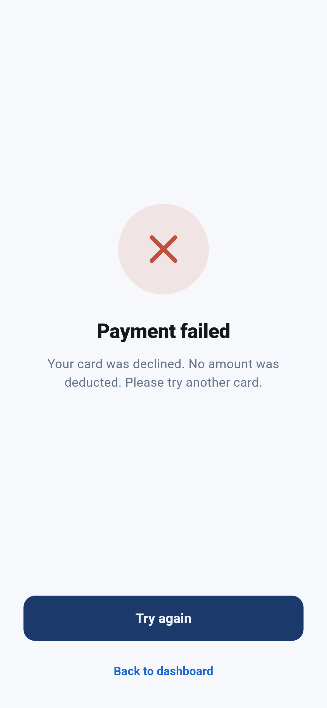

*Figure 9 — Failure state. Same layout, rust accent, honest copy about what to
do next.*

### 3.7 Profile

The profile screen renders differently per role. A buyer (Figure 10) sees
editable contact details. A seller (Figure 11) additionally sees verification
status and can re-enter the payment flow. Profile fields are the only user
document fields a client may update — the rules enforce it with an
`affectedKeys().hasOnly([...])` check.

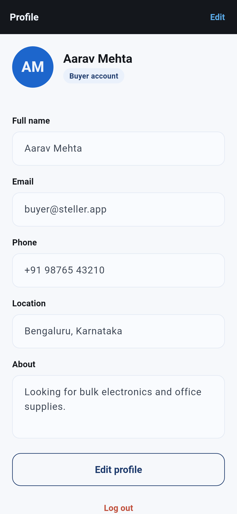

*Figure 10 — Buyer profile. Editable name, phone, location, and bio.*

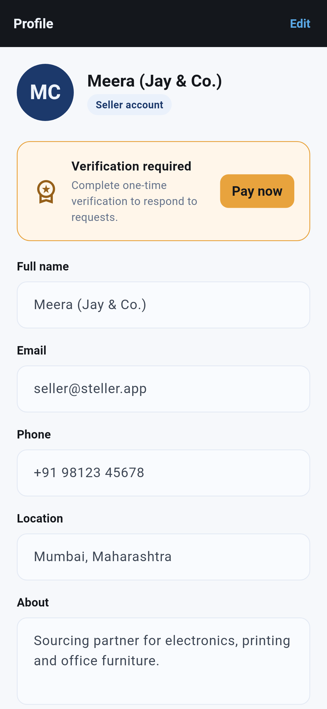

*Figure 11 — Seller profile. Verification status and the premium badge.*

## 4. Design System

The identity derives from the Steller's Jay: charcoal-dominant chrome, structural
blues, and one warm accent. The palette lives in `lib/theme.dart` as the
`Steller` class, with a documented intent for each value:

- **Charcoal (`#14171C`)** — app bars and dark surfaces; the identity carrier.
- **Deep blue (`#1C396B`)** — primary buttons and committed selections.
- **Azure (`#2F80ED`)** — graphics, borders, and focus states (≥ 3:1 contrast);
  `azureInk` is the same hue darkened for small text on light surfaces (AA).
- **Amber (`#E8A33D`)** and **rust (`#C0503C`)** — the single warm spark and the
  error colour respectively.

Neutrals are tinted toward the brand blue rather than pure grey, which keeps
cards and chips feeling part of one system. The theme is declared once through
`ThemeData` (buttons, inputs, cards, chips, dialogs, snack bars all inherit),
so a component cannot drift from the vocabulary. Accessibility commitments:
text ≥ 4.5:1, tap targets ≥ 44 px, and status never conveyed by colour alone —
every state pairs colour with an icon or label.

## 5. Data Model and Security

### 5.1 Collections

```
users/{uid}          name, email, role, phone, location, bio, subscribed
requests/{id}        title, category, description, budget, buyerId,
                     buyerName, responseCount, createdAt
chats/{chatId}       participants[2], requestId, requestTitle, buyerId,
                     sellerId, buyerName, sellerName, lastMessage, updatedAt
chats/{chatId}/messages/{messageId}
                     text, senderId, createdAt
```

Peer names are denormalised onto chat documents so neither user needs to read
the other's profile to render a conversation header — which in turn lets the
`users` collection stay private to its owner.

### 5.2 Rules

`firestore.rules` enforces least privilege per collection:

- **users** — readable and editable only by the owner. Updates are restricted by
  an `affectedKeys().hasOnly(['name', 'phone', 'location', 'bio', 'subscribed'])`
  check, so a buyer cannot promote themselves to seller; `role` is fixed at
  signup and the uid is pinned by the document path.
- **requests** — any signed-in user may read; only the poster may create (the
  rule compares `buyerId` to `request.auth.uid`); any signed-in user may update
  *only* the `responseCount` field; nobody may delete.
- **chats** — readable and writable only by the two participants. Updates may
  touch only `lastMessage` and `updatedAt` (the preview), so a participant
  cannot add a third member or repoint the chat at a different request.
  Messages are create-and-read only; updates and deletes are rejected outright.

The rules file also documents the one deliberate weakness: `subscribed` is
self-writable because the verification payment is a client-side mock.

## 6. Demo Data

`tool/seed.mjs` is a Firebase Admin script that provisions the demo world
idempotently (it checks for existence before creating anything): three auth
accounts — `buyer@steller.app`, `seller@steller.app`, and a second buyer,
`diya@steller.app`, all with password `demo1234` — four realistic requests
spanning Electronics, Printing, Furniture, and Bakery, and two active chats with
message history between the demo buyer and the demo seller. A fresh evaluator
who logs in as either demo account sees a marketplace that is already alive,
not an empty shell.

## 7. Verification

Two complementary strategies prove the app works:

1. **Widget tests with fakes.** `fake_cloud_firestore` and `firebase_auth_mocks`
   let the *real* widgets run against an in-memory Firestore seeded with the
   same shape as `seed.mjs` — no network, no mocked-out UI. The store, repos,
   models, and screens all execute their production code paths.
2. **Rendered screenshots.** The same harness produces the eleven figures in
   this report as golden files at a fixed 390 × 844 phone viewport. Real Roboto
   and Material Icons fonts are loaded into the test renderer, so the captures
   show true glyphs and iconography — including the live chat rendering seeded
   messages — rather than placeholder blocks.

Every screen in this report is therefore a photograph of the app itself running
its own code, not a design mock-up.

## 8. Limitations and Future Work

Honest boundaries of the prototype:

- **Payment is mocked.** The verification charge is simulated client-side; the
  rules comment states that production must confirm charges server-side (e.g.
  via a Stripe webhook writing the `subscribed` flag from a Cloud Function).
- **Password auth only.** No password reset, email verification, or OAuth.
- **Response counting is optimistic.** Sellers increment `responseCount` from
  the client; a transaction or counter function would make it exact under
  concurrency.
- **No notifications.** New messages appear in real time when the chat is open,
  but nothing pushes to the user when it is not.

Natural next steps: server-confirmed payments, push notifications via Firebase
Cloud Messaging, image attachments in requests and chat, and a Cloud Function
that maintains chat previews atomically.

## 9. Conclusion

Steller Market delivers a complete reverse-marketplace loop — signup, role
dashboards, posting, responding, real-time chat, verification payment, and
terminal result states — on a real Firebase backend with least-privilege
security rules and a single coherent design system. The screenshots in this
report were rendered from the running application, and the flows they show were
exercised end to end against seeded data. The result is a demo that needs no
narration: open it, sign in as a buyer or seller, and the product explains
itself.

---

*Repository: `steller_market` · Flutter 3.x / Dart ^3.13.4 · Firebase (Auth,
Firestore) · 11 rendered figures, generated from `test/screenshot_test.dart`.*
